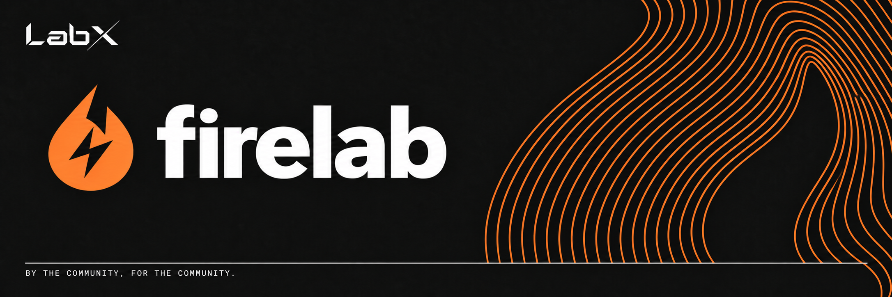
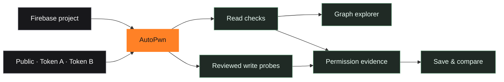
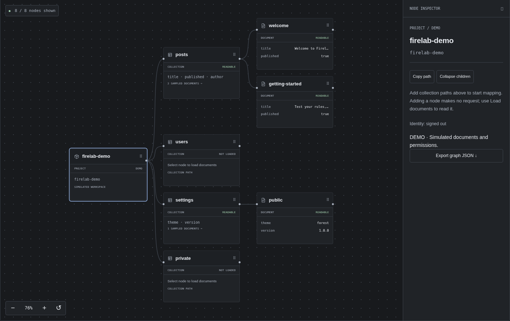

> By the community, for the community.

<div align="center">

# See your Firebase from every angle.

Inspect tokens. Compare access. Explore the graph.

**A lightweight Firebase workbench for pentesters and developers.**

[Get started](#start) · [Features](#features) · [Local lab](lab/README.md)

</div>

## Start

```bash
git clone https://github.com/theLabXHQ/firelab.git
cd firelab
python3 serve.py
```

Open **http://localhost:4173**. Try **Explore demo**, or paste your Firebase config and connect. Requires Python 3.9+; on Windows, use `py serve.py`.

To access it from another device on your network:

```bash
python3 serve.py --bind 0.0.0.0 --port 4173
```

## Features

- **AutoPwn** — discover Firestore paths, compare identities, and check create/update/delete permissions with reviewed temporary probes.
- **Tokens & requests** — inspect claims, verify ID token signatures, compare tokens, and send Firebase requests.
- **Graph explorer** — browse sampled documents, search, focus branches, and use fullscreen.
- **Service tools** — Authentication, Firestore, Realtime Database, Storage, and callable Functions.
- **Workspaces & scan history** — save project settings and manually save/compare scan evidence.
- **Secure project** — review configuration and export rule baselines with emulator tests.



<p align="center"><sub>Scoped checks → observed access → evidence you can inspect.</sub></p>



## First scan

1. Paste your config and connect.
2. Sign in, supply an ID token, or choose public access checks.
3. Open **AutoPwn**, select your paths, and start.
4. Review results or open them in **Graph explorer**.
5. Click **Save scan** to keep the evidence.

Reads are the default; writes require confirmation. AutoPwn checks bounded Firestore paths and sampled data, not every Firebase permission. A denied create leaves existing-document update/delete untested.

Tokens stay in memory. Saved workspaces and scan metadata use unencrypted local storage; graph and Activity exports can include project data.

Want local test accounts and tokens? Follow the [Firebase lab setup](lab/README.md).

[MIT license](LICENSE) · [Security reporting](SECURITY.md)
